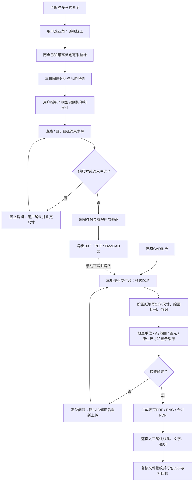

# CAD 助手流程与实施状态

更新：2026-11-14。产品基线以[第二版方案](agent-v2-plan.md)为准，本文件只记录已实现调用链。实线表示已实现的调用链；虚线表示仍需手动移交。模型输出不是尺寸真值，审核通过也不代表任意照片都可精确重建。

## 两个运行区域

| 区域 | 已有功能 | 边界 |
|---|---|---|
| GitHub Pages：studio.html | 校正、标定、图上确认、有限轮次模型与几何工具、导出 | 不能直接读取本地目录或运行Python；通用原生尺寸标注未接通 |
| 本机：cad-assistant 的 /delivery | 多DXF上传、尺寸清单表单、自动检查、后台生成、逐页预览确认、ZIP下载 | 本轮新增；不调用模型；上传仅到本机回环服务 |
| 本地命令：cad-job | inventory / check / build / package | 同一交付核心，也可由本地Agent调用 |

## 已完成的规则

- 实际尺寸与纸面比例分开，3:1的165毫米线段应标55。
- 当前DXF测量只作参考，不自动填为正确答案。
- 每个可打印原生尺寸都须有真实值、比例和来源；固定覆盖和陈旧显示缓存阻断。
- 单页失败不产出完整交付目录；交付文件变动阻断打包。
- 本地网页必须逐页确认才允许打包，修改输入后清除旧审核状态。
- 不支持的图元、角度/复杂标注不能静默放行；无原生尺寸明确提示人工核对。

## 后续顺序

1. 当前已接通本地交付台，先完成真实用户操作验收。
2. 将浏览器建图项目中的已确认尺寸转换为交付清单；在原生尺寸导出实现前不伪造核查通过。
3. 增加多图纸布局、单构件比例与标题栏编辑，同步重建几何和尺寸。
4. 增加预览与参考图的偏差定位；先提示问题，不用图像相似度替代尺寸准确性。
5. 用授权的教材例题持续做回归，保留失败原因和人工确认记录。

每步交付都应说明自动检查覆盖范围与人工审核范围，不把工具调用成功当作整套作业正确。
